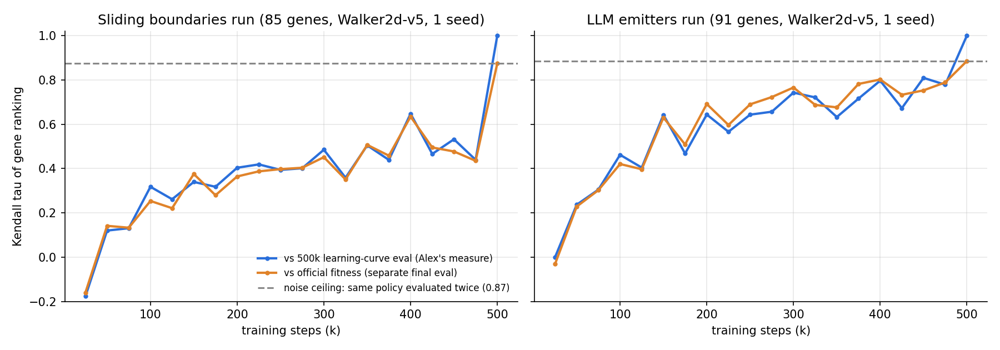

# Kendall tau: does a shorter training budget rank genes the same way? (Nov 14)

Data: the two midterm Walker2d-v5 runs (XQC, 500k steps × 1 seed per gene, VLM aux reward on),
genes with a complete learning curve (eval every 25k steps) and final return > 500.
Script: `analysis/scripts/kendall_walker.py` (same Kendall tau as `budget_curve_analysis.py`, plus noise checks).

| Kendall tau vs 500k | Sliding boundaries run (85 genes) | LLM emitters run (91 genes) |
|---|---|---|
| 100k | 0.32 | 0.46 |
| 200k | 0.40 | 0.64 |
| 300k | 0.48 | 0.74 |
| 400k | 0.65 | 0.80 |
| 475k | 0.44 | 0.78 |
| Same final policy evaluated twice | 0.87 | 0.88 |

- **Evaluation noise is small:** the 500k learning-curve eval and the separate final eval that sets fitness
  (same policy, 10 episodes each) agree at tau ≈ 0.87.
- **Training noise is the issue:** scores keep moving between checkpoints (475k vs 500k: 0.44 / 0.78),
  so any single stopping point is a snapshot of a still-changing policy.
- **300k ranks about as well as 475k** (0.48 vs 0.44; 0.74 vs 0.78), so stopping at 300k loses little
  beyond what late checkpoints already shuffle.
- **The sliding-boundaries run is lower because its genes are bunched** (half finished between 6,000 and 6,800),
  so near-ties flip. For pairs whose 500k scores differ by >10%, 300k orders 82% (sliding) / 93% (emitters)
  correctly; the final top-25% genes are in the top half at 300k for 73% / 100%.
- Caveats: 1 seed per gene (the 3-seed tiered config should rank more steadily); VLM aux reward on in both runs.
